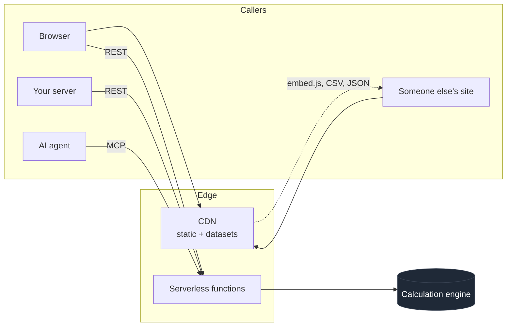
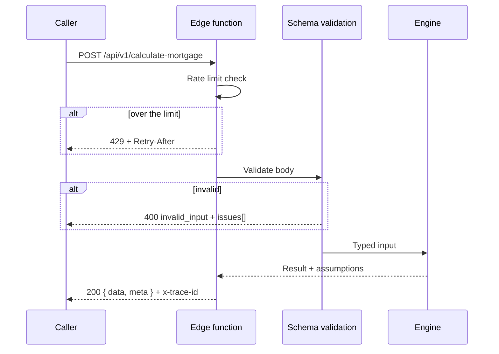

# Architecture

What a caller needs to know about how the service is put together — enough to
integrate well and to reason about failure. The implementation is closed source;
everything described here is observable from the outside.

## The shape of it



**One engine, four interfaces.** The website, the REST API, the MCP server and
the embedded widget all call the same calculation functions. That is why they
cannot disagree about a number — there is no second implementation to drift.

## Request path



Two properties worth relying on:

**Validation precedes computation.** A bad request fails naming the field rather
than returning a plausible number computed from a coerced value. You will never
receive a figure derived from a silently defaulted input.

**Calculations are pure.** They compute from the body you send, store nothing,
and hold no session. Retrying is always safe, responses are cacheable, and order
never matters.

## Deployment model

Serverless, on a global edge network. Three consequences that affect how you
should integrate:

| Property | Consequence for you |
| --- | --- |
| Each request may hit a fresh instance | No session state; every request stands alone |
| Instances are regional | Latency varies by origin; expect 50–400ms |
| Rate limiting is per-instance | Limits are ceilings, not guarantees — [see why](rate-limits.md) |

Static assets — the site, `embed.js`, the datasets — are served from the CDN and
never touch a function. That is why bulk data work should
[use the datasets](datasets.md) rather than the API.

## MCP

```mermaid
flowchart LR
  A[MCP client] -->|streamable HTTP| M[/mcp]
  M --> T[11 tools]
  M --> R[7 resources]
  M --> P[7 prompts]
  T --> ENG[(Same engine)]
  R --> D[(Published data)]

  classDef closed fill:#1f2937,stroke:#374151,color:#f9fafb
  class ENG closed
```

Stateless and unauthenticated. There is no session to establish — an
`initialize` is answered, but nothing is retained between calls, which is what
lets any client connect with a URL and no handshake bookkeeping.

Tools map one-to-one onto REST operations. Anything callable over MCP is
callable over HTTP and returns the same numbers.

## Data provenance

```mermaid
flowchart TD
  SRC[Published sources<br/>Census, HUD, FHFA, state authorities] --> ASM[Assumptions<br/>each with source + year]
  ASM --> ENG[(Engine)]
  ASM --> API[/api/v1/assumptions]
  ASM --> DS[Datasets<br/>CSV + JSON, CC BY 4.0]
  ENG --> RES[Result + assumptions block]

  classDef closed fill:#1f2937,stroke:#374151,color:#f9fafb
  class ENG closed
```

**Every result carries the assumptions that produced it.** A monthly payment
arrives with the property tax rate used, where that rate came from, and why
mortgage insurance was or was not applied. A number you cannot explain is a
number you cannot defend to a user, so the explanation travels with it.

Figures are **published averages**, not per-property assessments — correct for an
estimate, wrong for a specific home.

## What is not here

Being explicit, since this repository is the public face of a closed system:

- **The calculation engine** — formulas, the state tax dataset build, and the
  golden tests pinning them
- **The website** and its rendering
- **The MCP and REST server implementations** — routing, validation wiring,
  handler code
- **Telemetry** — collection, storage and dashboards
- **The developer platform** — key issuance, hashing, quota accounting
- **Infrastructure** — deployment configuration, Redis, environment management

None of it is needed to integrate. If you hit something these docs do not
explain, that is a documentation bug worth
[reporting](https://github.com/chetanmane/usmortgagecalc-api/issues) — the
answer should be here rather than inferable only from source.

## Reliability

| Signal | Where |
| --- | --- |
| Live status | [/status](https://www.usmortgagecalc.com/status) — checks real endpoints from your browser |
| Usage statistics | [/stats](https://www.usmortgagecalc.com/stats) |
| Uptime | Deliberately reported as **Unknown** — nothing on the deployment measures it, and a self-reported figure would be a guess |

The status page runs its checks from the visitor's own browser rather than
reporting a server's opinion of itself, because a status page that reports its
own health is the one that stays green during an outage.
